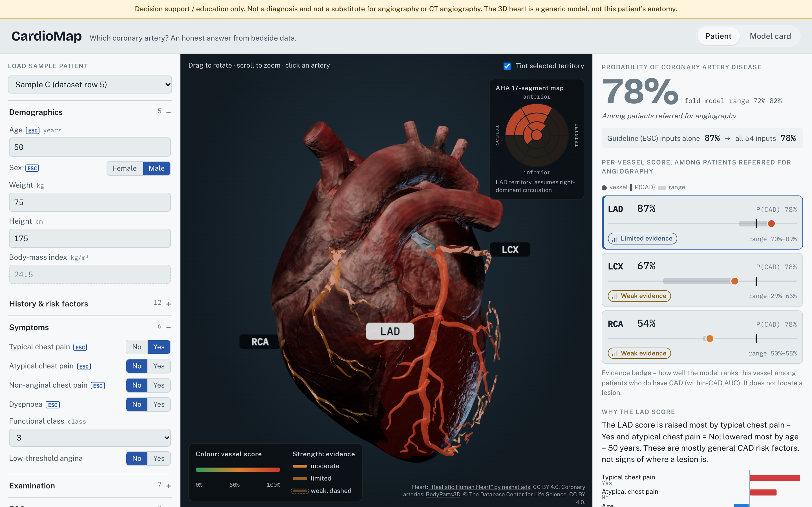
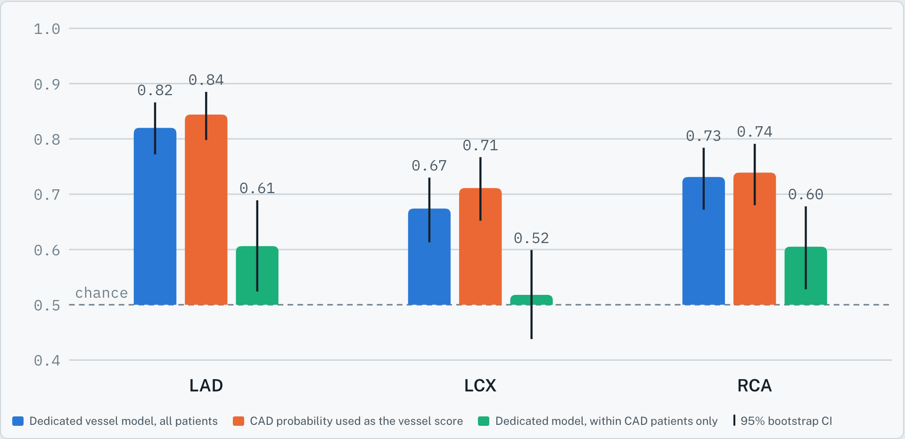

# CardioMap: an honest map of coronary risk

Track A entry, Multimodal AI Hackathon 2026, IIT Mandi.

> **Decision support / education only.** Not a diagnosis and not a substitute for angiography or CT angiography. The 3D heart is a generic model, not this patient's anatomy. Every probability is **among patients referred for angiography**, the population of the dataset.

CardioMap takes bedside data (history, symptoms, exam, ECG, labs, echo), estimates the probability of coronary artery disease (CAD) and paints a per-vessel score onto a generic 3D heart. The vessel scores sit beside the overall CAD probability, each with an evidence badge, because the main finding of the analysis is that **vessel predictions from bedside data mostly re-encode overall CAD risk**. The app is built so that nobody reads a red LAD as "the lesion is in the LAD".



## Run it

### Docker (one command)

```bash
docker build -t cardiomap . && docker run --rm -p 8000:8000 cardiomap
```

Open http://localhost:8000. The image builds the frontend, retrains the served models (about 10 s) and runs the tests during the build.

### Local

Requirements: Python 3.11+ (tested on 3.12), Node 20+.

```bash
python3.12 -m venv .venv && .venv/bin/pip install -r requirements.txt
.venv/bin/python ml/train.py                 # optional: rebuilds artifacts/ (trained models are committed)
(cd frontend && npm ci && npm run build)
.venv/bin/uvicorn backend.app.main:app --port 8000
```

Frontend development with hot reload: run the backend as above, then `cd frontend && npm run dev` (proxies `/api` to port 8000).

### Tests

```bash
.venv/bin/python -m pytest -q tests
```

- `tests/test_leakage.py`: no label column (`LAD`, `LCX`, `RCA`, `Cath`) in any model's features, including fold and baseline models; encoding identical to `ml/reproduce.py`; the API returns 400 for any label field.
- `tests/test_api.py`: response contract, colour function, input validation, BMI derivation.
- `tests/test_scene_color.py` (needs `pip install -r requirements-dev.txt`): opens the built app in headless Chromium (Playwright), loads each sample patient and checks that the colour rendered on each artery mesh equals the API's `scene_state` colour. Uses Playwright's Chromium if installed, otherwise a local Chrome, Brave or Chromium (or `$CARDIOMAP_BROWSER`).

Write-up: `docs/writeup.md` (source) and `docs/writeup.pdf` (6 pages, rebuilt with `python docs/build_writeup.py`). Screenshots: `python docs/capture_screenshots.py` with the backend running.

The full evaluation is `ml/reproduce.py` (about 20 min on one core). Its outputs are `ml/metrics.json` and `ml/oof_predictions.csv`; see `ml/README_reproduce.md`.

## Architecture

```
data/*.xlsx ──► ml/features.py ──► ml/train.py ──► artifacts/
                (encoding, schema,   (model choice,    models.joblib, feature_schema.json,
                 validation)          calibration)     metrics.json, presets.json, anatomy_map.json
                                                            │
ml/reproduce.py ──► ml/metrics.json ────────────────────────┘ (copied, plus derived evidence badges)

backend/app/main.py (FastAPI)          frontend/ (Vite, React, TypeScript, react-three-fiber)
  POST /api/predict  ◄──────────────── patient form generated from /api/schema
  GET  /api/schema /metrics /presets   3D heart: colours only from scene_state
       /anatomy /meta                  results panel, model card (numbers from /api/metrics)
  serves frontend/dist on /
```

- **Features** (`ml/features.py`): the encoding is copied from `reproduce.py` (Sex male = 1; VHD none/mild/moderate/severe = 0–3; BBB one-hot, drop first; Y/N = 1/0; `Exertional CP` dropped as constant). The 54 clinical inputs, their labels, units, groups, observed ranges and defaults (median or mode) live in `artifacts/feature_schema.json`, the single source of input definitions. Values outside the training range are rejected. BMI is derived from weight and height.
- **Served models** (`ml/train.py`): for each target (CAD, LAD, LCX, RCA), logistic regression vs random forest (the two prespecified families of `reproduce.py`) is chosen by a separate 5-fold CV on the training data, never by reported results. Chosen: CAD LR, LAD RF, LCX RF, RCA LR. The final model is `CalibratedClassifierCV(method="sigmoid", cv=5)` fit on all 303 rows. Five calibrated fold models give the "fold-model range" shown as the band, which is model variability, not a confidence interval for the patient. A calibrated logistic regression on the 12 ESC features is the guideline baseline shown next to the CAD probability.
- **Vessels are independent models.** The hierarchical P(CAD) × P(vessel | CAD) model gave no gain in the analysis, so it is not served.
- **Explanations**: SHAP values come from `shap.LinearExplainer` (LR, log-odds, all 303 rows as background) or `shap.TreeExplainer` (RF, probability scale) applied to the **uncalibrated** base model refit on all rows, not to the calibrated wrapper. The top 8 contributions are shown in clinical units; the BBB dummies are summed back into one input.
- **Colour**: one function, `prob_to_color(p)` in the backend (green to amber to red). The frontend only uses the `scene_state` colours it receives.
- **Evidence badge** per vessel: mean of LR and RF within-CAD AUC of the dedicated model scores; below 0.60 weak, 0.60–0.70 limited, above 0.70 moderate. In the 3D view, moderate is solid, limited is 70% opacity and weak is 45% opacity with a dashed outline.
- **3D heart** (`frontend/public/heart.glb`, 3.7 MB): the textured surface of "Realistic Human Heart" by neshallads (CC BY 4.0) with the real coronary arteries from BodyParts3D (CC BY 4.0) fitted onto it. Built in two steps:
  1. `tools/build_heart.py <bp3d folder>` builds an anatomical heart from BodyParts3D (`tools/bp3d_heart.glb`, committed): the original coronary meshes, `LAD` (with diagonals, conus and septal branches), `LCX`, `RCA` (with conus, marginal, posterior ventricular and posterior interventricular branches; right-dominant) and `LM`, plus an epicardial shell reconstructed around the cavity meshes. Inputs: `partof_BP3D_4.0_obj_99.zip` and `partof_element_parts.txt` from the BodyParts3D download page, unzipped into one folder.
  2. `tools/fit_surface.py tools/bp3d_heart.glb <scene.gltf>` aligns that heart to the textured model (rigid + scale ICP, then non-rigid NRICP registration), carries the arteries with the same smooth deformation and seats each one on the surface (half-embedded, no floating or buried segments; checked by `tests/test_heart_fit.py`), stores smooth per-vertex territory weights on the surface (`_TERRITORY`: nearest artery with a soft edge, ventricles only, balanced to the AHA 17-segment proportions LAD 7 : LCX 5 : RCA 5), and desaturates the texture so the API's artery colours stay readable. Input: the glTF download of the Sketchfab model.
  Both need `pip install -r requirements-dev.txt`. The painted vessels in the texture are decoration; the coloured, clickable arteries are the BodyParts3D meshes.
- **Sample patients** are the first dataset rows matching four fixed case definitions (no CAD; LAD only; three-vessel; LCX/RCA without LAD), excluding row 93. Labels stay hidden until "Reveal". These rows were in the training data, so their predictions are optimistic, and the UI says so.

## Results

From `ml/metrics.json` (`reproduce.py`: repeated stratified 5×10 CV, seed 2026, 2,000 patient-level bootstrap resamples; 303 patients, 216 with CAD). AUC with 95% CI.

**Classification metrics** (threshold 0.5, fixed in advance; out-of-fold predictions from the same cross-validation, all inputs; 95% bootstrap CIs; `ml/classification_metrics.py`)

| Target | Model | Accuracy | Precision | Recall | F1 | ROC-AUC |
|---|---|---|---|---|---|---|
| CAD | LR | 0.86 (0.82–0.90) | 0.90 (0.85–0.93) | 0.91 (0.88–0.95) | 0.90 (0.88–0.93) | 0.93 (0.90–0.96) |
| LAD | LR | 0.75 (0.70–0.80) | 0.77 (0.71–0.83) | 0.81 (0.75–0.87) | 0.79 (0.74–0.84) | 0.82 (0.77–0.87) |
| LCX | LR | 0.63 (0.58–0.69) | 0.55 (0.44–0.65) | 0.40 (0.32–0.49) | 0.46 (0.37–0.54) | 0.67 (0.61–0.73) |
| RCA | LR | 0.69 (0.64–0.74) | 0.60 (0.51–0.70) | 0.49 (0.40–0.58) | 0.54 (0.46–0.62) | 0.73 (0.67–0.78) |
| CAD | RF | 0.87 (0.83–0.90) | 0.87 (0.83–0.92) | 0.95 (0.92–0.98) | 0.91 (0.88–0.94) | 0.93 (0.89–0.95) |
| LAD | RF | 0.79 (0.74–0.83) | 0.78 (0.72–0.83) | 0.90 (0.85–0.94) | 0.83 (0.79–0.87) | 0.85 (0.81–0.90) |
| LCX | RF | 0.67 (0.62–0.72) | 0.66 (0.54–0.77) | 0.34 (0.26–0.43) | 0.45 (0.36–0.54) | 0.75 (0.69–0.80) |
| RCA | RF | 0.67 (0.62–0.72) | 0.63 (0.51–0.76) | 0.32 (0.23–0.40) | 0.42 (0.33–0.51) | 0.72 (0.66–0.78) |

Precision and accuracy are inflated by the high prevalence of a referred population (CAD 71%). Vessel recall is low at 0.5 because vessel scores are rarely confident.

**Vessel scores vs CAD probability**

| Vessel | Model | Dedicated model | CAD probability as score | Dedicated minus CAD prob. | Within CAD (dedicated) | Evidence |
|---|---|---|---|---|---|---|
| LAD | LR | 0.820 (0.772–0.866) | 0.844 (0.798–0.885) | -0.024 (-0.047 to -0.000) | 0.606 (0.524–0.689) | limited (0.638) |
| LAD | RF | 0.855 (0.810–0.895) | 0.849 (0.802–0.889) | +0.006 (-0.014 to 0.027) | 0.670 (0.585–0.753) | |
| LCX | LR | 0.674 (0.613–0.730) | 0.711 (0.652–0.767) | -0.037 (-0.087 to 0.010) | 0.518 (0.438–0.599) | weak (0.570) |
| LCX | RF | 0.748 (0.693–0.801) | 0.722 (0.661–0.780) | +0.026 (-0.019 to 0.070) | 0.622 (0.543–0.701) | |
| RCA | LR | 0.731 (0.672–0.784) | 0.739 (0.680–0.791) | -0.008 (-0.055 to 0.039) | 0.605 (0.528–0.678) | weak (0.597) |
| RCA | RF | 0.719 (0.659–0.776) | 0.714 (0.654–0.768) | +0.004 (-0.044 to 0.055) | 0.589 (0.510–0.661) | |

No dedicated vessel model beats the CAD probability used as the vessel score. In one case (LAD, LR) the CI only just excludes zero, in the direction of the dedicated model being *worse*. Within CAD patients, vessel AUCs are 0.52–0.67.

**What each modality adds (CAD)**

| Feature set | LR | RF |
|---|---|---|
| ESC inputs (12) | 0.910 (0.868–0.947) | 0.901 (0.858–0.939) |
| + ECG | 0.927 (0.892–0.957) | 0.914 (0.876–0.947) |
| + ECG + echo | 0.939 (0.909–0.965) | 0.933 (0.900–0.962) |
| All 55 columns | 0.927 (0.895–0.956) | 0.925 (0.890–0.955) |

ECG + echo over the ESC inputs: LR +0.029 (0.013 to 0.048), RF +0.031 (0.011 to 0.053).



## Limitations

- One centre, 303 patients, all already referred for angiography. Probabilities do not transfer to screening or emergency populations.
- No external validation. Bootstrap CIs ignore refit variance and are somewhat narrow.
- Vessel scores mostly re-encode overall CAD risk and must not be read as lesion location. Vessel labels are stenotic/normal only.
- Row 93 (0-based) has a stenotic vessel but is labelled no CAD; it is kept as published.
- The served models are refit on all rows; the reported metrics are cross-validated estimates of the same model families, not of the exact served objects.
- The heart is one generic model, not this patient's anatomy; the arteries are fitted to it automatically and territories assume right-dominant circulation.

## Licences and data

- Dataset: Alizadehsani R., Roshanzamir M., Sani Z. *Extension of Z-Alizadeh Sani dataset*. UCI Machine Learning Repository, DOI 10.24432/C5461K. CC BY 4.0. SHA-256 of the file used: `739343245c2ba578b541370217531750d8e936022f928b83e0d91756caa3ff0b` (checked at load).
- 3D heart surface: this work is based on "Realistic Human Heart" (https://sketchfab.com/3d-models/realistic-human-heart-3f8072336ce94d18b3d0d055a1ece089) by neshallads (https://sketchfab.com/neshallads), licensed under CC BY 4.0 (http://creativecommons.org/licenses/by/4.0/). Changes: textures downsized and desaturated, mesh split into territory regions.
- Coronary arteries: **BodyParts3D, © The Database Center for Life Science licensed under CC Attribution 4.0 International** (https://dbarchive.biosciencedbc.jp/en/bodyparts3d/). Changes: decimated, aligned and projected onto the surface above.
- Both credits are shown on the 3D view.
- Fonts bundled from npm, no runtime CDN: Bricolage Grotesque, Public Sans, IBM Plex Mono (SIL Open Font License 1.1).
- Libraries: scikit-learn, pandas, NumPy, SHAP, FastAPI, React, three.js, react-three-fiber, drei, Vite (each under its own open-source licence).

## AI assistance

Tools: **Claude Code** (Anthropic, Claude Opus 5.5) and **Claude** (Anthropic).

- `ml/reproduce.py`, `ml/metrics.json`, `ml/oof_predictions.csv` and the analysis design were produced with Claude.
- With Claude Code: `ml/features.py`, `ml/train.py`, the artifacts, the FastAPI backend, the React/three.js frontend (including the charts and the BodyParts3D heart pipeline), all tests, the Dockerfile, the screenshot script and this README.
- The team chose the research question, reviewed the outputs and is responsible for every claim in the submission.

## Repository

```
data/          dataset (hash-checked)
ml/            features.py, train.py, reproduce.py (+ its metrics and OOF predictions)
artifacts/     trained models (models.joblib), schema, metrics, presets, anatomy map
backend/app/   FastAPI app
frontend/      Vite + React + TypeScript + react-three-fiber (public/heart.glb)
tools/         build_heart.py (BodyParts3D -> bp3d_heart.glb), fit_surface.py (-> frontend/public/heart.glb)
tests/         leakage, API and rendered-colour tests
docs/          6-page write-up (md + pdf), screenshot script, figures
```
