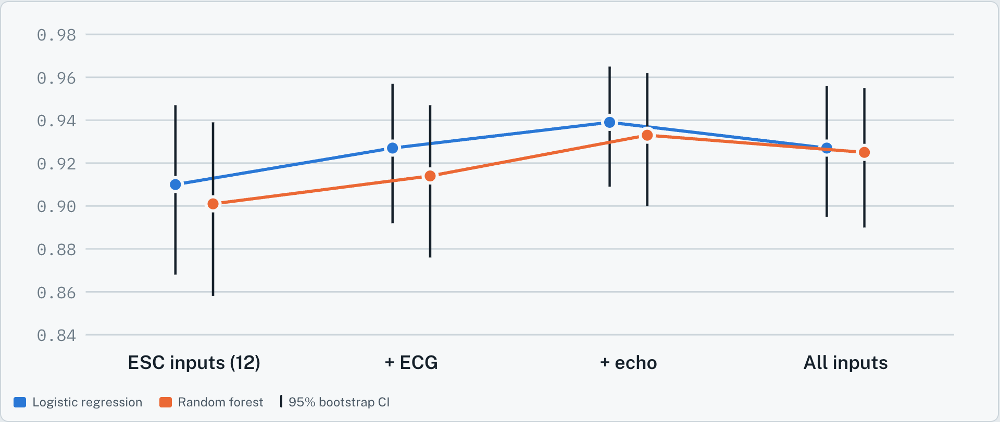
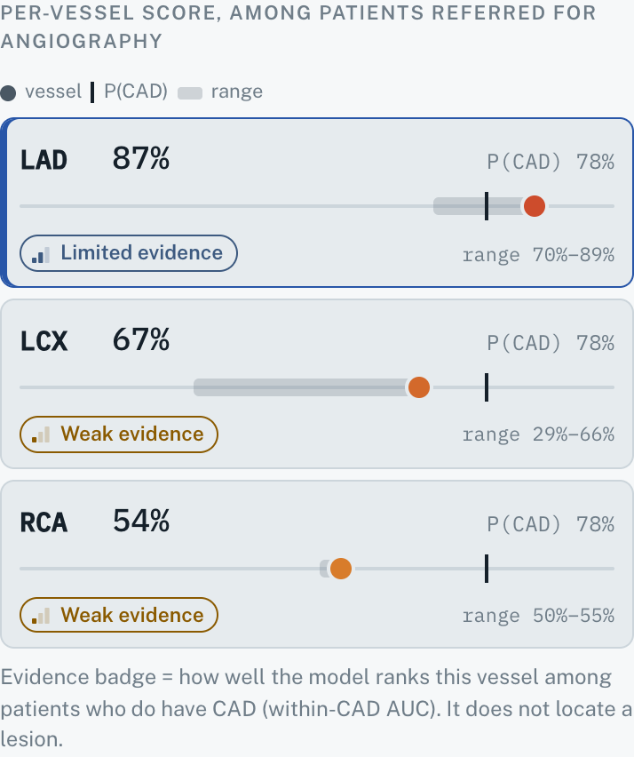

# CardioMap: an honest map of coronary risk from bedside data

*Track A, Multimodal AI Hackathon 2026, IIT Mandi.*

> Decision support / education only. Not a diagnosis and not a substitute for angiography or CT angiography. The 3D heart is a generic model, not this patient's anatomy. Every probability in this document and in the app is among patients referred for angiography.

## 1. Problem and claim

Coronary artery disease (CAD) is confirmed by angiography, an invasive test. Bedside data (history, symptoms, examination, ECG, laboratory values and echocardiography) is available earlier and costs little. Many projects on the Z-Alizadeh Sani data go one step further and predict *which* artery is stenosed, then draw that on a heart. A coloured artery invites a strong reading: "the lesion is here".

The question behind this entry is whether that reading is earned. The answer from a reproducible, paired evaluation is mostly no:

1. Using the overall CAD probability as the score for each vessel ranks patients about as well as a dedicated vessel model (LAD AUC about 0.85, LCX and RCA about 0.72).
2. Among patients who do have CAD, the dedicated vessel models reach AUCs of only 0.52 to 0.67. The models mostly recognise *who* has disease, not *where* it is.
3. A hierarchical model, P(CAD) × P(vessel | CAD), adds nothing over independent vessel models.
4. Adding ECG and echo to the 12 guideline (ESC) inputs does improve CAD detection: logistic regression AUC 0.910 to 0.939, difference +0.029 (95% CI 0.013 to 0.048).

CardioMap is built around these findings rather than despite them. Each vessel score is shown beside the overall CAD probability on a shared scale, every vessel carries an evidence badge, the guideline-only baseline is always visible, and the model card puts the evaluation one click away.

## 2. Data

The UCI *Extension of Z-Alizadeh Sani* dataset (Alizadehsani, Roshanzamir and Sani; DOI 10.24432/C5461K; CC BY 4.0): 303 patients referred for angiography at one centre, 216 with CAD. Vessel labels are stenotic or normal for LAD (177 stenotic), LCX (119) and RCA (114). By number of stenotic vessels: 0 in 86 patients, 1 in 87, 2 in 67 and 3 in 63. The file is hash-checked at every load (SHA-256 `739343245c2ba578…caa3ff0b`).

Inputs are 54 clinical variables in seven groups: demographics (5), history and risk factors (12), symptoms (6), examination (7), ECG (7), laboratory (14) and echocardiography (3). After encoding (sex male = 1; valvular disease none/mild/moderate/severe = 0 to 3; bundle branch block one-hot with first level dropped; yes/no = 1/0) the model matrix has 55 columns.

Data-quality notes, kept visible in the app:

- `Exertional CP` is constant (`N`) and is dropped.
- Row 93 (0-based) has a stenotic vessel but is labelled no CAD. It is kept as published, not silently corrected.
- Lesion severity and position within a vessel are not recorded, so "stenotic LAD" covers everything from a distal branch to the left main.

## 3. Methods

### 3.1 Evaluation design (`ml/reproduce.py`)

The design was fixed before results were seen:

- **One set of splits for everything.** Repeated stratified 5-fold cross-validation, 10 repeats, seed 2026, stratified on the number of stenotic vessels. Every target and every model uses the same splits, so all comparisons are paired.
- **Two prespecified model families, reported separately.** L2 logistic regression (C = 0.1, standardised inputs) and random forest (200 trees, minimum 3 samples per leaf). No best-of selection on test results.
- **Scores and intervals.** Each patient's out-of-fold probability is averaged over the 10 repeats. AUCs and 95% CIs come from 2,000 patient-level bootstrap resamples of those scores; differences use paired bootstraps. These intervals ignore refit variance, so they are somewhat narrow.
- **Comparisons.** For each vessel: a dedicated model on all patients; the CAD probability used as the vessel score; a hierarchical score P(CAD) × P(vessel | CAD), where the conditional model is trained only on CAD-positive training rows; and AUCs restricted to CAD patients. For CAD: an ablation from the 12 ESC inputs, adding ECG, then echo, then all inputs. Calibration of the CAD model is reported by sex.
- **Leakage.** `LAD`, `LCX`, `RCA` and `Cath` are asserted absent from every input matrix. `Cath` is the CAD target.

### 3.2 Served models (`ml/train.py`)

The app needs one model per target, fit on all the data. For each target (CAD, LAD, LCX, RCA) logistic regression and random forest are compared by a separate 5-fold CV on the training data; the reported numbers above are never used for this choice. The chosen family is wrapped in sigmoid calibration (`CalibratedClassifierCV`, 5-fold) and fit on all 303 rows. Choices: CAD logistic regression (CV AUC 0.932 vs 0.923), LAD random forest (0.844 vs 0.825), LCX random forest (0.724 vs 0.647), RCA logistic regression (0.747 vs 0.682).

Two further pieces are served:

- **Fold-model range.** Five calibrated models, one per training fold of the selection split, are kept. The app shows the minimum to maximum of their predictions. This shows model variability, not a confidence interval for the patient, and the full-data prediction can sit slightly outside it.
- **Guideline baseline.** A calibrated logistic regression on the 12 ESC inputs only, shown next to the CAD probability.

### 3.3 Evidence badge

Each vessel gets one badge, computed from the evaluation rather than the served model: the mean of the logistic regression and random forest within-CAD AUCs of the dedicated model scores. Below 0.60 is *weak*, 0.60 to 0.70 *limited*, above 0.70 *moderate*. Result: LAD limited (0.638), LCX weak (0.570), RCA weak (0.597). No vessel reaches moderate.

### 3.4 Explanations

SHAP values explain the uncalibrated base model refit on all rows, not the calibrated wrapper: `LinearExplainer` for logistic regression (log-odds scale, all 303 rows as background) and `TreeExplainer` for random forest (probability scale). The two bundle-branch-block columns are summed back into one input. The app shows the top eight contributions in clinical units with a one-sentence summary. For vessel targets the sentence ends: "These are mostly general CAD risk factors, not signs of where a lesion is."

## 4. Results

### 4.1 Vessel scores mostly re-encode CAD risk

| Vessel | Model | Dedicated model | CAD probability as score | Difference (95% CI) | Within CAD only |
|---|---|---|---|---|---|
| LAD | LR | 0.820 (0.772–0.866) | 0.844 (0.798–0.885) | −0.024 (−0.047 to −0.000) | 0.606 |
| LAD | RF | 0.855 (0.810–0.895) | 0.849 (0.802–0.889) | +0.006 (−0.014 to 0.027) | 0.670 |
| LCX | LR | 0.674 (0.613–0.730) | 0.711 (0.652–0.767) | −0.037 (−0.087 to 0.010) | 0.518 |
| LCX | RF | 0.748 (0.693–0.801) | 0.722 (0.661–0.780) | +0.026 (−0.019 to 0.070) | 0.622 |
| RCA | LR | 0.731 (0.672–0.784) | 0.739 (0.680–0.791) | −0.008 (−0.055 to 0.039) | 0.605 |
| RCA | RF | 0.719 (0.659–0.776) | 0.714 (0.654–0.768) | +0.004 (−0.044 to 0.055) | 0.589 |

No dedicated vessel model beats the CAD probability. Five of six differences have CIs spanning zero; the sixth (LAD, logistic regression) only just excludes zero, and in the direction of the dedicated model being *worse*. Within CAD patients the scores fall to 0.52 to 0.67.

The hierarchical model does not help. Hierarchical minus dedicated AUC differences range from −0.012 to +0.015; the only CI that excludes zero (LAD, random forest, −0.012, CI −0.022 to −0.002) again favours the simpler model. Training the conditional model on CAD patients only also does not raise within-CAD discrimination (differences −0.121 to −0.001). CardioMap therefore serves independent vessel models.

### 4.2 Modalities add to CAD detection

| Feature set | Logistic regression | Random forest |
|---|---|---|
| ESC inputs (12) | 0.910 (0.868–0.947) | 0.901 (0.858–0.939) |
| + ECG | 0.927 (0.892–0.957) | 0.914 (0.876–0.947) |
| + ECG + echo | 0.939 (0.909–0.965) | 0.933 (0.900–0.962) |
| All 55 columns | 0.927 (0.895–0.956) | 0.925 (0.890–0.955) |

ECG and echo on top of the guideline inputs: +0.029 (0.013 to 0.048) for logistic regression and +0.031 (0.011 to 0.053) for random forest. Adding the remaining laboratory and examination variables does not improve on that.

### 4.3 Calibration

Out-of-fold calibration slopes of the CAD model are above 1 (logistic regression 1.18 overall; 0.96 in men and 1.66 in women), meaning uncalibrated predictions are too cautious, more so in women. The served models are sigmoid-calibrated. The full table by sex is in the app's model card.

## 5. The application

**Layout.** Patient form on the left, a 3D heart in the centre, results on the right; a model card in a second tab. The form is generated from `feature_schema.json`, grouped by modality, with the 12 ESC inputs marked. Missing values default to the dataset median or mode, and the results panel says how many inputs are at defaults.

**The 3D heart** combines two CC BY 4.0 sources. The surface is a textured anatomical heart ("Realistic Human Heart" by neshallads). The coronary arteries are the real anatomical meshes from BodyParts3D (DBCLS): the LAD with its diagonal, conus and septal branches, the circumflex, and the RCA with its marginal and posterior interventricular branches (right-dominant). A build script registers the BodyParts3D heart to the textured surface (rigid, then non-rigid), carries the arteries with the same smooth deformation, seats every segment on the surface, and splits the surface into each artery's territory by nearest vessel. The texture is desaturated so the artery colours stay readable. The model is 3.2 MB, renders on demand only and runs on a laptop without a dedicated GPU.

**Two visual channels, never mixed.** Colour (green to amber to red) is the vessel score, computed by a single backend function; the frontend only paints the colours it receives. Opacity is evidence: moderate solid, limited at 70%, weak at 45% with a dashed outline. With current data no vessel is solid, which is the point.

**The vessel track** is the core reading aid. Each vessel row places its score, its fold-model range and a tick for P(CAD) on one 0 to 100% line. A reader sees at once that the vessel score usually sits near the overall CAD probability.

**Guideline baseline.** Next to the CAD probability: "Guideline (ESC) inputs alone 87% → all 54 inputs 78%". The comparison shows what the extra modalities change for this patient.

**Explanations.** Selecting a vessel (in the scene or the list) shows its SHAP chart in clinical units, a plain-language sentence, its territory tinted on the heart and highlighted on an AHA 17-segment bullseye labelled "assumes right-dominant circulation".

**Sample patients.** Four real dataset rows (no CAD, LAD only, three-vessel, LCX/RCA without LAD) are chosen by a fixed rule, not by model output. Labels stay hidden until "Reveal", which also states that these patients were in the training data and their predictions are optimistic.

**Safeguards.** The disclaimer banner is fixed at the top of every screen. Every percentage is labelled "among patients referred for angiography". The API rejects `LAD`, `LCX`, `RCA` and `Cath` as inputs with HTTP 400, rejects unknown fields and values outside the training range, and the model card shows every number from `metrics.json` with its CI.

## 6. Verification

- **Leakage tests** inspect every fitted object (final, SHAP base, fold models, baseline): none sees a label column, and each was fit on exactly the declared feature list. A test re-runs the encoding snippet from `reproduce.py` and requires an identical matrix.
- **API tests** check the response contract, the colour function, input validation and BMI derivation, and that label fields return 400 whatever their value.
- **Rendered-colour test.** A headless browser loads each sample patient and reads the colour actually set on each artery mesh. It must equal the API's colour exactly. All four presets pass.
- **Container check.** The Docker build retrains the models and runs the tests; the container gives the same model choices and predictions as a local run.

## 7. Limitations and responsible use

- One centre, 303 patients, all already referred for angiography. Probabilities will not transfer to screening, primary care or emergency populations, where CAD prevalence is far lower than 71%.
- No external validation. Bootstrap CIs ignore refit variance.
- The served models are refit on all rows; the reported metrics describe the same model families under cross-validation, not the exact served objects.
- Vessel labels are binary and coarse. Within-CAD AUCs of 0.52 to 0.67 mean the vessel scores must not be used to plan or replace angiography.
- SHAP values describe the uncalibrated base model and are associations, not causes.
- The heart is one generic model, not this patient's anatomy; the arteries are fitted to it automatically and the territories assume right-dominant circulation.

The intended use is education and discussion: showing clinicians and students what bedside data can and cannot say about coronary anatomy.

## 8. Reproducibility and AI disclosure

Everything runs from the repository: `ml/reproduce.py` regenerates the evaluation (about 20 minutes on one core), `ml/train.py` the served artifacts (about 10 seconds), and `docker build` the whole app. Environment: Python 3.12, scikit-learn 1.9.1 for serving (the evaluation was run with 1.8.0), FastAPI, React, three.js and react-three-fiber. Fonts and libraries are bundled; nothing is fetched from a CDN at runtime.

**AI assistance.** The evaluation script and analysis were produced with Claude (Anthropic). The feature pipeline, served models, backend, frontend, tests, Dockerfile, README and this write-up were built with Claude Code (Anthropic, Claude Opus 5.5). The team chose the question, reviewed the outputs and is responsible for every claim.

## References

1. Alizadehsani R, Roshanzamir M, Sani Z. Extension of Z-Alizadeh Sani dataset. UCI Machine Learning Repository. DOI 10.24432/C5461K.
2. Knuuti J, et al. 2019 ESC Guidelines for the diagnosis and management of chronic coronary syndromes. *European Heart Journal* 2020;41:407–477.
3. neshallads. Realistic Human Heart. Sketchfab, https://sketchfab.com/3d-models/realistic-human-heart-3f8072336ce94d18b3d0d055a1ece089. CC BY 4.0.
4. Mitsuhashi N, et al. BodyParts3D: 3D structure database for anatomical concepts. *Nucleic Acids Research* 2009;37:D782–D785. Data: BodyParts3D, © The Database Center for Life Science, CC BY 4.0.
5. Cerqueira MD, et al. Standardized myocardial segmentation and nomenclature for tomographic imaging of the heart (AHA 17-segment model). *Circulation* 2002;105:539–542.
6. Lundberg SM, Lee S-I. A unified approach to interpreting model predictions. *NeurIPS* 2017.
7. Platt J. Probabilistic outputs for support vector machines and comparisons to regularized likelihood methods. *Advances in Large Margin Classifiers*, 1999.
